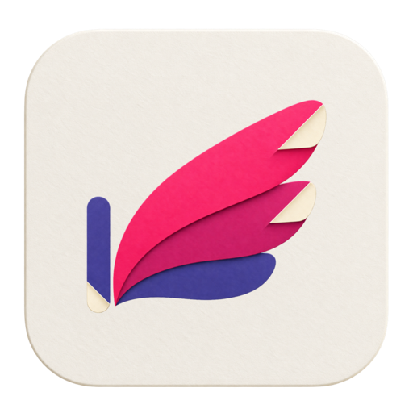
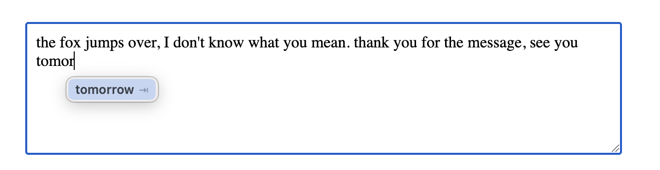

<p align="center"></p>

<h1 align="center">Sandalphon</h1>

<p align="center">Autocorrect for everything you type on your Mac. Quiet, fast, and entirely on your machine.</p>

<p align="center">
  <a href="https://github.com/IftatBhuiyan/sandalphon/releases/latest"></a>
  <a href="https://github.com/IftatBhuiyan/sandalphon/actions/workflows/ci.yml"></a>
  <a href="LICENSE"></a>
</p>

Sandalphon replaces the built-in macOS autocorrect in every app: Notes, Mail, browsers, chat apps. You type;
it fixes slips as you go and otherwise stays out of sight. Nothing appears on screen unless you ask for it.

```
you type   i got it form the store yestreday. its a amazing place , you should of come
you get    I got it from the store yesterday. It's an amazing place, you should have come
```

## What it does

- **Fixes typos when you press space.** Swapped letters, missed and doubled letters, neighbouring keys, missing
  apostrophes, missing spaces. It only changes a word when it is confident, and Backspace straight after puts
  your word back and remembers never to touch it again.
- **Goes back when later words prove an earlier one wrong.** "form" is a real word, so it is left alone, until
  "the store" follows it. Sandalphon then steps back, fixes it and returns the caret while you keep typing.
- **Capitals, punctuation and common grammar slips.** Sentence starts, names, places and acronyms (*london*,
  *nasa*, *mr smith*), *could of*, *your
  welcome*, *a apple*, repeated words, a space before a comma, double space for a full stop.
- **Suggestions only when you ask.** Press <kbd>⌥ Esc</kbd> for completions and corrections of the word you are
  on, or select a word first to see alternatives. Right-click a selection and choose *Services › Fix Typos with
  Sandalphon* to correct a whole passage.
- **Learns how you write.** Your own words and phrases, kept in one file on your Mac that you can read or erase.
- **Knows when to stay out.** It is off in terminals, code editors and password managers by default, ignores
  password fields, search boxes and address bars, and leaves URLs, emails, paths and `camelCase` alone.

<p align="center"></p>

## Install

1. Download `Sandalphon-x.y.z.dmg` from the [latest release](https://github.com/IftatBhuiyan/sandalphon/releases/latest)
   and drag Sandalphon to Applications.
2. Open it and follow the setup window: allow **Accessibility** access (macOS requires this for any app that
   reads and corrects typing), and switch off the built-in autocorrect so the two do not fight.

It needs macOS 14 or later and runs on Apple silicon and Intel. Updates arrive in the app.

## Privacy

Sandalphon sees every key you press, so this matters more than any feature:

- Everything runs on your Mac. What you type is never stored and never leaves the machine.
- The only network request is the update check against this repository, which you can switch off.
- There is no telemetry, analytics or crash reporting.
- The code is here to read, and you can [build it yourself](#building-from-source).

More detail is in [SECURITY.md](SECURITY.md).

## How good is it?

Honest numbers, reproducible with `scripts/benchmark.sh`:

| Test | Result |
|---|---|
| Finger slips planted in the 6,000 most common words | 86% fixed automatically, 1.1% changed to the wrong word, the rest left alone; the right word is among the suggestions 97% of the time |
| 670 real human misspellings with no surrounding context ([Birkbeck sets](https://norvig.com/spell-correct.html)) | 63% fixed automatically, 4.3% changed to the wrong word; the right word is offered 89% of the time |
| 1,180 misspellings in sentences written by schoolchildren ([Holbrook corpus](https://www.dcs.bbk.ac.uk/~ROGER/corpora.html)), a deliberately hard set | 41% fixed, 20% changed to the wrong word, 39% left; 0.1% of the 22,000 correct words around them changed |
| The 40,000 most common English words, typed correctly | none altered, apart from deliberate fixes such as *cant* → *can't* |
| 131,000 correctly typed words in unseen sentences, re-examined by the look-back pass | 8 wrongly changed (about 1 in 16,000) |
| Work per keystroke | 0.13 ms |

Where it is weak: spellings by ear that are far from the real word ("wated" for "waited") are often missed or
changed to a nearer word; a wrong word that is itself a word ("there" for "their") is rarely caught; three- and
four-letter slips are often ambiguous and are left alone; uncommon first names
typed in lowercase are sometimes "corrected" (16% in the benchmark); and it only knows English. Capitalised
names in the middle of a sentence are never touched.

## How it works

A keyboard event tap watches typing on a dedicated thread. The word in progress is corrected by a
noisy-channel model: candidate words come from a weighted edit-distance search over a trie (key adjacency,
transpositions, doubled letters), and are ranked by an interpolated trigram language model built from 124
million words of dialogue plus web word frequencies. Nothing in the key path waits on another process: the
correction is precomputed while you type, and the Accessibility API is only consulted off-thread to confirm
that the field really contains what was typed before anything is replaced.

[docs/ARCHITECTURE.md](docs/ARCHITECTURE.md) has the details.

## Building from source

You need Xcode 16 or later.

```sh
git clone https://github.com/IftatBhuiyan/sandalphon.git
cd sandalphon
swift test -c release              # engine tests
scripts/benchmark.sh               # quality numbers
scripts/build-app.sh --install     # build, install to /Applications and launch
```

Without a Developer ID certificate the app is ad-hoc signed, which works but makes macOS ask for
Accessibility access again after every rebuild.

## Contributing

Bug reports, word-list additions and engine improvements are all welcome. Start with
[CONTRIBUTING.md](CONTRIBUTING.md). The most useful report is a wrong correction: what you typed, what you got,
and which app you were in.

`main` is protected: changes come in as pull requests from a fork, pass CI, and are squash-merged. Ideas for
new behaviour go to [Discussions](https://github.com/IftatBhuiyan/sandalphon/discussions/categories/ideas)
first.

## Licence

The code is [MIT licensed](LICENSE). The language data comes from several sources with their own terms,
listed in [Data/README.md](Data/README.md).
